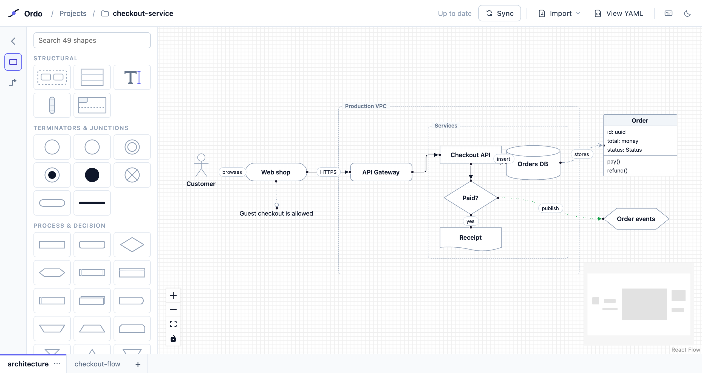
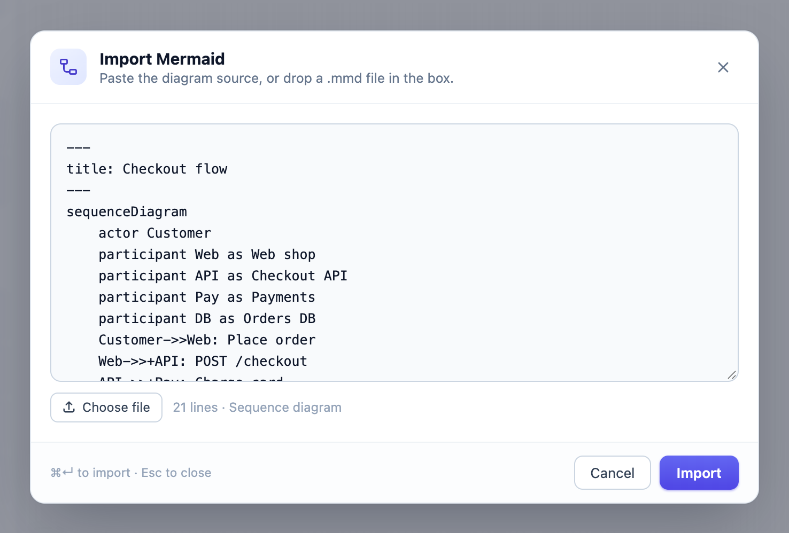
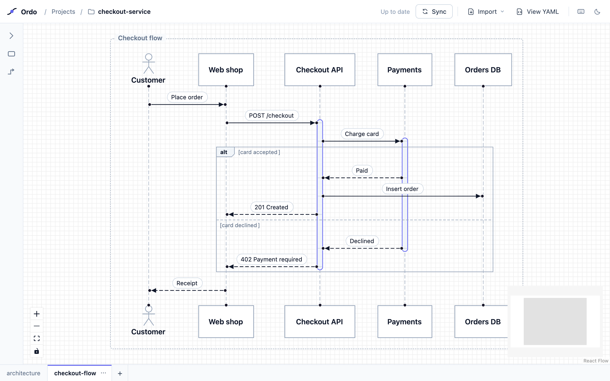

<p align="center">
  <picture>
    <source media="(prefers-color-scheme: dark)" srcset="docs/assets/ordo-logo-dark.svg">
    
  </picture>
</p>

<h3 align="center">Diagrams that live in your repo.</h3>

<p align="center">
  Draw on an infinite canvas, or paste Mermaid and get a diagram you can drag.<br>
  Every diagram is a small YAML file in <code>.ordo/</code> that you diff, review and commit like code.
</p>

<p align="center">
  <a href="#get-started">Get started</a> ·
  <a href="#drawing">Drawing</a> ·
  <a href="#your-diagrams-are-files">Files &amp; Sync</a> ·
  <a href="#import-from-mermaid">Mermaid</a> ·
  <a href="#work-with-an-ai-agent">Agents</a> ·
  <a href="#settings">Settings</a> ·
  <a href="#keyboard-shortcuts">Shortcuts</a>
</p>

<p align="center">
  <a href="LICENSE"></a>
  <a href="#work-with-an-ai-agent"></a>
  
</p>

<picture>
  <source media="(prefers-color-scheme: dark)" srcset="docs/assets/hero-dark.png">
  
</picture>

Architecture diagrams go stale because they live somewhere else: in a
whiteboard tool with its own login, in a PNG on the wiki, or in a Mermaid block
whose layout you can't touch.

Ordo keeps them next to the code they describe. Open a repo and draw, and each
diagram lands in `.ordo/` as a plain YAML file. Move a box, and `git diff`
shows one line. Change the file in a PR, with `git pull` or through an AI
agent, and the canvas catches up by itself. Ordo runs on your machine, and
nothing leaves it.

- **Draw** with 49 flowchart shapes, groups, UML classes, sequence-diagram
  frames and styled lines.
- **Import** Mermaid flowcharts and sequence diagrams as diagrams you can edit.
- **Commit** each diagram as a readable file, and review it in the same PR as
  the code.
- **Hand it to an agent**, which can write a diagram, check it and look at it
  before you do.

> [!NOTE]
> Ordo is early. Drawing, Mermaid import, the file format and repo sync all
> work today.

## Get started

### Install and start Ordo

You need Node.js `^20.19.0` or `>=22.12.0`.

```bash
git clone https://github.com/Srinu0342/ordo-editor.git
cd ordo-editor
npm install
npm run build
npm start
```

Open http://localhost:5173. Ordo has no login, so it only answers on this
machine. To run it in Docker instead, or to choose which folders it can open,
see [Settings](#settings).

### Open a project

Ordo opens on **Open a project**. A project is any folder, usually a repo.

- **Recent** lists the repos you opened lately.
- **Browse** walks the folders under your workspace root, which is your home
  folder unless you [set another one](#settings). Click a folder to go into it,
  and **Open** to pick it. Folders that are git repos, or already hold Ordo
  diagrams, carry a `git` or `.ordo` badge.

Opening a repo writes nothing. If it has no diagrams yet, Ordo asks you to name
the first one, and `.ordo/` is created when you do. If it has diagrams, the
editor opens on the first one.

**Projects** in the header closes the project and takes you back to the list.

> [!TIP]
> On macOS, the first time you browse Desktop, Documents or Downloads, the
> system may ask whether your terminal can read them. If you refuse, Ordo says
> it can't read the folder. You can allow it later under System Settings ›
> Privacy & Security › Files and Folders.

### Draw your first diagram

1. Drag a shape from the **Nodes** panel on the left onto the canvas. Type in
   the panel's search box to find one by name.
2. Drag a second shape next to it.
3. Click the first shape to show its connection points, then drag from one of
   them onto the second shape to draw a line between them.
4. Double-click a shape's label to name it, and press Enter when you're done.
5. Press **Sync** (or `⌘S`) to write the diagram to `.ordo/<name>/ordo.yaml`.
   Sync also runs by itself every 10 seconds.
6. Commit the `.ordo/` folder like any other.

## The editor at a glance

| Area | What's there |
| ---- | ------------ |
| **Header** | Where you are (Ordo, then the open project), the diagram's sync status and **Sync**, **Import**, **View YAML**, the keyboard shortcuts, and the light and dark switch. |
| **Sidebar** | Two panels: **Nodes** holds every shape to drag onto the canvas, and **Edges** styles and routes lines. Collapse it to give the canvas more room. |
| **Canvas** | An infinite grid. The buttons in the corner zoom in and out and fit the diagram to the screen, and the minimap shows where you are. |
| **Text bar** | Appears over the canvas when you select something with text, to set its size, weight and alignment. |
| **Tabs** | One tab per diagram in the repo, along the bottom. `+` makes a new one. |

Each tab remembers its zoom and position in this browser, so it opens where you
left it. A tab you haven't opened in this browser yet is fitted to its diagram.

## Drawing

### Shapes

The **Nodes** panel holds 49 shapes in six groups. Drag one onto the canvas to
place it, and use the search box to filter the panel by name.

| Group | Shapes |
| ----- | ------ |
| Terminators & junctions | Circle, Start, Double circle, Stop, Junction, Summary, Terminal, Fork / join |
| Process & decision | Process, Event, Decision, Preparation, Subprocess, Divided process, Shaded process, Multi-process, Delay, Manual operation, Priority, Loop limit, Collate, Extract, Manual file |
| Input, output & manual | Input / output, Output / input, Manual input, Display, Card, Paper tape, Internal storage, Communication link |
| Documents | Document, Lined document, Multi-document, Tagged document, Tagged process |
| Storage | Database, Direct access storage, Disk storage, Data store, Stored data |
| Annotation & free form | Comment, Comment (right), Comment (both), Odd, Bang, Cloud, Note, Actor |

Select a shape to resize it from its handles.

### Groups, classes, text, tubes and frames

The **Structural** section at the top of the Nodes panel holds five nodes that
do more than draw an outline.

- **Group** holds other nodes. Drop a node so that it sits entirely inside a
  group and it joins that group; the group lights up while you drag to show
  where the node will land. Drag it out again to take it out. Moving a group
  moves everything in it, and groups can nest.
- **Class** stacks compartments, for UML classes and ER entities.
  Double-click the name or a row to edit it, and double-click the empty space
  in a compartment to add a row.
- **Text** is words with no frame around them, on as many lines as you type.
  It opens for typing as soon as you drop it: Enter starts a new line, and Esc,
  `⌘Enter` or a click away finishes. Text left empty removes the node.
- **Timeline tube** is the activation bar of a sequence diagram. Drop it on a
  line, such as a lifeline, and it rides that line: move the line and the tube
  follows. Use **More taps** and **Fewer taps** to change how many points
  messages can connect to, the rotate handle to turn it (hold Shift to snap to
  15°), and **Release from the edge**, or a drag away from the line, to free
  it.
- **Fragment** is the loop, alt, opt or par frame of a sequence diagram.
  Double-click the operator or a guard to edit it, and use the stepper on the
  frame to add an operand (else, and, option) or remove the last one. A frame
  never takes in the nodes inside it, so clicks still reach the lifelines and
  messages it surrounds.

### Lines

To draw a line, select a node to show its four connection points, then drag
from one onto another node. Every node shows its connection points while you
draw, so you can see where the line can land. You can also click a connection
point, then click the one you want the line to end on.

The **Edges** panel styles lines. With lines selected it restyles them; with
none selected it sets the style of the next line you draw. Selecting a line
opens the panel for you.

- **Text:** double-click a line to give it a label, or type in the panel's
  Text field while one line is selected.
- **Colour:** six swatches, or any colour from the picker. The darkest swatch
  follows the theme, so it stays readable in light and dark.
- **Weight:** 1, 1.5, 2, 3 or 4 px.
- **Pattern:** solid, dashed or dotted.
- **Ends:** a marker for each end, from 14: none, arrow, filled arrow, circle
  and cross for flowcharts; inheritance, composition, aggregation and
  dependency for UML; and one, many, zero or one, zero or many, and one or many
  for ER cardinality.
- **Routing:** **Straight** (point to point), **Orthogonal** (right angles
  only), **Rounded step** (right angles with softened corners) or **Curved**.

### Text

Double-click any label to edit it. In a shape or on a line, Enter finishes and
Shift+Enter starts a new line. Press Enter with a single text node selected to
start typing in it.

Select anything with text, including several things at once and lines as well
as nodes, and the text bar appears:

- **Size**, from 8 to 72 px. The − and + buttons step each item from its own
  size, so a title stays bigger than the body text selected with it. Typing a
  size sets them all to it.
- **Weight:** Regular, Semibold or Bold.
- **Alignment:** left, centre or right, for text nodes.
- **Reset**, once you've changed something, returns each item to its own
  size, weight and alignment.

### Selecting and arranging

- Click to select, `⌘`-click to add to the selection, Shift-drag to lasso, and
  `⌘A` to select everything.
- Drag empty canvas to pan; scroll or pinch to zoom.
- Nodes snap to a 10 px grid. While you drag, guides show when the selection
  lines up with the nodes around it, and lining up wins over the grid.
- Paste lands under your pointer, and pasting into a group puts the copies in
  it. Duplicate (`⌘D`) copies without touching your clipboard.
- Undo and redo go back and forward over the last 30 changes.
- Delete or Backspace removes the selection, along with any lines left with no
  end.

## Your diagrams are files

Each diagram is one file, `.ordo/<name>/ordo.yaml`, and one tab along the
bottom of the canvas. The file holds the structure first and the layout after a
`---`, so moving a box changes one line:

```diff
   receipt: { x: 30, y: 260 }
-  queue: { x: 1080, y: 300 }
+  queue: { x: 1080, y: 380 }
   order: { x: 1080, y: 60, w: 190, h: 150 }
```

Saving keeps the file's comments, key order and indentation, so diffs stay
small and reviewable. Ordo never runs git: you commit `.ordo/` like any other
folder, and review diagrams in the same PR as the code they describe.

### Manage diagrams

- **New:** `+` at the end of the tabs. The name is checked as you type.
- **Rename:** the `⋯` on the open tab, or double-click the tab. The diagram's
  folder moves and the file inside is untouched, so unsynced edits stay on the
  canvas and the next Sync writes them under the new name.
- **Delete:** the `⋯` on the open tab. Ordo asks first, then removes
  `ordo.yaml`, and the folder too if nothing else is in it. A file that changed
  on disk since it was loaded is never deleted: Sync first to see the change.
- **View YAML** in the header shows the canvas as its file, to copy or
  download.
- **Import › Ordo YAML file…** opens a `.yaml` file from anywhere. It replaces
  the canvas, and the next Sync writes it to the open tab.

The repo and the open diagram are part of the URL, so a reload or a bookmark
brings you back to the same place:

```
http://localhost:5173/?source=local&repo=code/payments-api&tab=checkout
```

### Sync

Sync keeps the canvas and the file in step, in both directions. Edit on the
canvas and Sync writes the file. Change the file, through `git pull`, a
teammate's commit or an agent, and Sync loads it. It runs by itself every 10
seconds, and straight away when you press **Sync** or `⌘S`.

The header shows where the open diagram stands: **Up to date**, **Unsynced**,
**Syncing…** or **File has errors**. The open tab shows a dot while it has
unsynced edits.

Sync never overwrites a file it hasn't seen. When it can't decide on its own,
it asks:

| What happened | Your choices |
| ------------- | ------------ |
| Both the canvas and the file changed | **Keep mine** writes the canvas over the file. **Take the file's** loads the file and drops your edits. **Download mine** saves the canvas as a file so you can decide later. |
| The file changed and no longer reads as an Ordo diagram | Fix the file and it loads within a few seconds, or press Sync to load it now. If the canvas has edits too, you can keep yours or download them. |
| The file was deleted, by git or by hand | **Recreate from canvas** writes it back. **Close tab** drops the diagram. |
| You leave a diagram with unsynced edits | **Sync and switch**, or **Discard and switch**. |

The automatic Sync never interrupts you: it says once that something needs a
choice, and leaves it for the next time you press Sync. Every question offers
Cancel, and pressing Enter never overwrites or deletes anything.

One Ordo serves every repo under the workspace root, and each browser tab can
have a different repo open.

## Import from Mermaid

<table>
  <tr>
    <td width="44%">
      <picture>
        <source media="(prefers-color-scheme: dark)" srcset="docs/assets/import-dark.png">
        
      </picture>
    </td>
    <td>
      <picture>
        <source media="(prefers-color-scheme: dark)" srcset="docs/assets/sequence-dark.png">
        
      </picture>
    </td>
  </tr>
  <tr>
    <td>Paste Mermaid source, or drop in a <code>.mmd</code> or <code>.md</code> file…</td>
    <td>…and get boxes, lifelines, activation bars and frames you can move, restyle and nest.</td>
  </tr>
</table>

Choose **Import › Mermaid diagram…** in the header. Paste Mermaid source, drop
a file (`.mmd`, `.mermaid`, `.md` or `.txt`) on the dialog, or browse for one.
The dialog says what kind of diagram it found as soon as the text arrives.
Press **Import** or `⌘Enter`.

| Diagram | What you get |
| ------- | ------------ |
| Flowchart | Mermaid's own layout, so the import looks the way Mermaid drew it. Subgraphs become groups, and Mermaid's extended `A@{ shape: … }` shapes map onto Ordo's. |
| Sequence | Participants, lifelines, activations (as timeline tubes), messages, notes, and loop, alt, opt, par, critical and break frames, laid out by Ordo. |

The import arrives as one selected group, to the right of whatever is already
on the canvas, so several imports line up side by side. From there it's an
ordinary Ordo diagram: move, restyle and nest anything in it.

- In a Markdown file, Ordo imports the first ` ```mermaid ` block.
- A front-matter `title:` names the group the diagram lands in.
- Other Mermaid types (class, state, ER, Gantt and so on) are recognised, and
  Ordo tells you it can't import them yet rather than guessing.

Import is one way: Ordo doesn't export to Mermaid.

## Work with an AI agent

Agents are good at writing text files, and an Ordo diagram is a text file. Ask
yours to write one into `.ordo/<name>/ordo.yaml`. With the repo open in Ordo,
the new diagram shows up as a tab within about ten seconds, and later edits to
the open one load by themselves. When you edit on the canvas, the agent sees
your changes the next time it reads the file.

Ordo also serves MCP at `/mcp`. Through it the agent learns the format, then
checks its diagram for mistakes and sees it as a picture, so it can fix the
layout before you look. The tools only read: they never write a file or touch
your canvas. To connect Claude Code:

```bash
claude mcp add --transport http ordo http://localhost:5173/mcp
```

Any other client that speaks Streamable HTTP can use the same URL, while Ordo
is running. What the agent is taught is plain Markdown in
[docs/agents/](docs/agents/).

## Settings

Ordo reads its settings from a `.env` file at the top of its folder. Start from
the sample, which explains each one:

```bash
cp .env.sample .env
```

| Setting | What it does | Default |
| ------- | ------------ | ------- |
| `ORDO_WORKSPACE` | The folder whose repos Ordo can open. The project picker starts here. A leading `~` is your home folder. | `~` |
| `PORT` | The port for the editor and `/mcp`. | `5173` |
| `HOST` | The address Ordo listens on. Keep it on `localhost`: Ordo has no login, and anything that can reach the port can read and write `.ordo/` in your repos. | `localhost` |
| `CONFIG` | Editor switches, as one JSON object. `MINI_MAP` shows or hides the minimap, for example `{"MINI_MAP": false}`. | Minimap on |

Restart Ordo after changing `.env`. A variable set in the shell wins over the
file, so `ORDO_WORKSPACE=~/notes npm start` works for a one-off.

<details>
<summary><b>Run Ordo in Docker</b></summary>

```bash
docker build -t ordo .
docker run --rm -p 127.0.0.1:5173:5173 \
  -v ~/code:/workspace/code \
  -v ~/Desktop/personal-projects:/workspace/personal-projects \
  ordo
```

Each `-v` mounts a folder of repos under `/workspace`, the workspace root
inside the container. Keep the `127.0.0.1:` in `-p`: without it Docker
publishes the port on every network interface, and anyone who can reach your
machine could read and write the mounted repos. On Linux, add
`--user "$(id -u):$(id -g)"` so the files Ordo writes belong to you. Pass
`CONFIG` with `-e`, such as `-e CONFIG='{"MINI_MAP": false}'`; the image sets
`HOST`, `PORT` and `ORDO_WORKSPACE` itself.

</details>

## Keyboard shortcuts

Use `⌘` on macOS and `Ctrl` elsewhere. In the app, the keyboard button in the
header shows the main ones.

| Shortcut | Action |
| -------- | ------ |
| Shift-drag | Lasso select |
| `⌘`-click | Add to the selection |
| `⌘A` | Select all |
| `⌘C` / `⌘X` / `⌘V` | Copy / cut / paste at the pointer |
| `⌘D` | Duplicate |
| `⌘Z` / `⇧⌘Z` | Undo / redo |
| `⌘S` | Sync |
| Delete / Backspace | Delete the selection |
| Double-click a label | Edit it |
| Double-click a line | Give it text |
| Enter | Edit the selected text node |
| Enter / Shift+Enter | While editing a label: finish / new line |
| Esc or `⌘Enter` | While editing a text node: finish |
| Double-click the open tab | Rename the diagram |
| `⌘Enter` / Esc | In the import dialog: import / close |

## Contributing

Issues and pull requests are welcome. [Developing Ordo](docs/development.md)
covers running from source, tests and adding a shape, and
[How Ordo works](docs/architecture.md) explains the design.

## License

[MIT](LICENSE) © 2026 Subhadip Hazra
